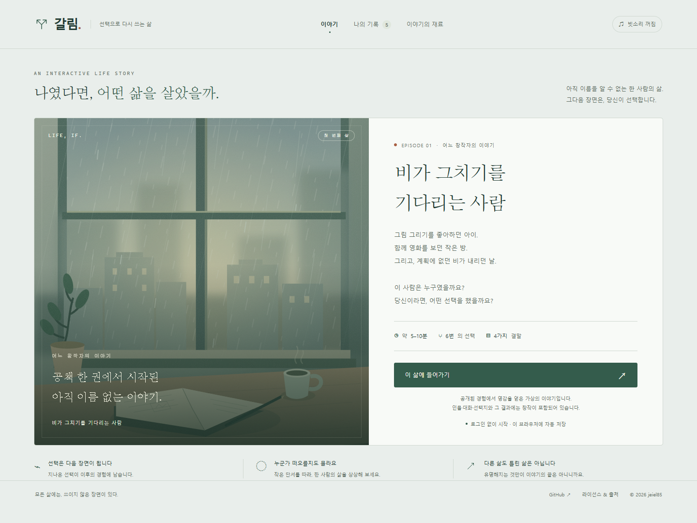

<div align="center">

# 갈림 · L:IF:E

**나였다면, 어떤 삶을 살았을까.**

이름을 알 수 없는 한 사람의 삶에 들어가,<br>
여섯 번의 선택으로 다음 장면을 만드는 한국어 인터랙티브 인생 게임.

[](LICENSE)
[](CONTENT_LICENSE.md)
[](game/dist/app.js)
[](https://github.com/jeiel85/l-if-e/actions/workflows/ci.yml)

[**라이브 데모에서 플레이 ↗**](https://galim-first-life.spicystar16.chatgpt.site) · [이야기 설계](docs/episode-01-design.md) · [기여하기](#기여하기)



</div>

## 첫 번째 삶: 비가 그치기를 기다리는 사람

그림을 그리던 공책. 함께 영화를 보던 작은 방. 계획에 없던 비가 내리는 첫 촬영.

누군가의 공개된 경험에서 출발했지만, 이곳에서 다음 장면을 만드는 것은 **당신의 선택**입니다. 영화 제작을 시작할 수도, 글을 쓸 수도, 일과 창작을 함께 이어갈 수도 있습니다. 유명해지는 것만을 정답으로 삼지 않습니다.

**가상의 인물 ‘서도윤’의 이야기**이며, 실제 전기나 실존 인물의 선택을 맞히는 퀴즈가 아닙니다. 등장인물·대화·선택지·선택 이후의 결과에는 창작이 포함됩니다. 실존 인물의 다른 미래를 예측한다고 주장하지 않습니다. 정체의 정답을 공개하지 않으며, 출처는 게임 내 별도로 접힌 항목에서 확인할 수 있습니다.

## 플레이

1. **이 삶에 들어가기**를 눌러 시작합니다.
2. 장면을 읽고 세 가지 선택 중 하나를 고릅니다. 데스크톱에서는 숫자 키 `1`, `2`, `3`도 사용할 수 있습니다.
3. 선택이 남긴 경험을 읽고 다음 장면으로 넘어갑니다.
4. 여섯 장면을 마치면 결말과 선택의 기록을 돌아봅니다.
5. 다른 선택으로 다시 살아보거나, 완성한 삶을 복사해서 별도로 보관합니다.

| 경험 | 구현 |
| --- | --- |
| 앞선 선택의 영향 | 세 번째 장면의 사건 자체가 갈라지고, 이전 협업·학습 경험이 이후 제안의 결과에 반영됩니다. |
| 네 가지 결말 | 작은 영화의 연출자 · 이야기를 쓰는 사람 · 두 개의 일상 · 함께 만드는 사람 |
| 729개의 선택 조합 | 6개 장면 × 3가지 선택. **729개의 별도 장편 시나리오라는 뜻은 아닙니다.** 공유 장면과 조건별 문장으로 구성됩니다. |
| 자동 저장과 기록 | 진행·완성한 경로를 현재 브라우저에 저장합니다. 동일 경로는 중복 보관하지 않으며 최근 100개까지 보관합니다. |
| 저장 실패 처리 | 저장소가 차단되거나 가득 차면 안내하고, 현재 창에서 플레이를 이어갑니다. |
| 분위기 | 직접 그린 SVG 창가 일러스트, 선택적으로 켤 수 있는 합성 빗소리 |
| 접근성 | 키보드 선택, 포커스 표시, 본문 바로가기, 반응형 화면, 동작 줄이기 설정 반영 |

현재 첫 회차는 읽는 속도에 따라 약 **5–10분**입니다. 계정, 결제, 외부 AI API가 필요하지 않습니다.

## 로컬 실행

**Node.js 22 이상**을 준비합니다. 별도 의존성 설치나 빌드 과정이 없습니다.

```bash
git clone https://github.com/jeiel85/l-if-e.git
cd l-if-e
npm start
```

[http://127.0.0.1:4317](http://127.0.0.1:4317)을 엽니다. 포트가 사용 중이면 `PORT` 환경 변수로 변경할 수 있습니다.

```powershell
# PowerShell
$env:PORT = '8080'
npm start
```

```bash
# macOS / Linux
PORT=8080 npm start
```

`file://`로 HTML을 직접 열지 말고 HTTP 서버로 실행해 주세요. 로컬 서버는 미리보기 전용입니다.

### 정적 사이트로 배포

```bash
npm run build
```

의존성 설치 없이 `game/dist/`의 파일을 루트 `dist/`에 복사하고 원본과 바이트 일치를 확인합니다. 배포 디렉터리는 **`dist/`**입니다. ES 모듈을 제공할 수 있는 정적 호스팅에서 실행할 수 있습니다. Sites 배포 설정은 `.openai/hosting.json`에 있습니다. 자체 사이트로 포크할 때는 이 파일의 원본 프로젝트 ID를 새 사이트의 값으로 바꿔 주세요.

## 검증

```bash
npm run check
npm test
```

Node 내장 테스트 러너로 전체 729개 선택 조합의 장면 연결과 결말 도달, 네 가지 결말의 도달 가능성, 과거 선택의 후속 영향, 잘못된 저장 데이터 거부를 확인합니다. 외부 테스트 의존성은 없습니다. `main` 푸시와 PR에서 GitHub Actions가 동일한 검증을 실행합니다.

브라우저 검증 범위와 결과는 [검증 기록](docs/verification.md)에 정리합니다.

## 구조

```text
game/
  dist/
    index.html       # 앱 셸과 시작점
    app.js           # 렌더링·선택·저장·기록·음향
    story.js         # 시나리오·분기·결말·저장 데이터 검증
    style.css        # 디자인 토큰·반응형·접근성
    art.svg          # 직접 제작한 창가 일러스트
    favicon.svg      # 갈림 심벌
  tests/
    story.test.mjs   # 전체 경로와 분기 검증
scripts/
  build.mjs          # 정적 배포 파일 복사와 바이트 검증
  serve.mjs          # 의존성 없는 로컬 미리보기 서버
docs/
  episode-01-design.md
  verification.md
  screenshots/
LICENSE              # 소스 코드: MIT
CONTENT_LICENSE.md   # 콘텐츠 적용 범위와 표시 방법
LICENSES/
  CC-BY-4.0.txt      # 콘텐츠 라이선스 전문
```

## 콘텐츠를 수정하려면

`story.js`의 `sceneFor()`에서 장면과 선택 결과를, `endingFor()`에서 결말을 수정합니다. `app.js`에 화면과 저장 처리가 있고 `style.css`에 디자인 토큰이 있습니다. 분기나 결말을 바꾼 뒤에는 전체 경로 검증을 실행해 주세요.

새 인물을 추가할 때는 공개 기록의 출처와 창작 부분을 먼저 구분해 문서화합니다. 확인하지 못한 대화·감정·선택을 실존 인물의 사실로 표시하지 않습니다. 첫 에피소드의 [제작용 기획 문서](docs/episode-01-design.md)에는 조사 대상과 출처가 나옵니다. 추측을 즐기고 싶다면 플레이 후 읽어 주세요.

## 개인정보와 저장

앱에는 로그인·서버 데이터베이스·분석 SDK·외부 AI 호출이 없습니다. 선택은 현재 브라우저의 `localStorage`에 남고 기기 간에 동기화되지 않습니다. 이름 추측 답변은 저장·전송하지 않습니다. 브라우저 데이터를 지우면 진행·완성 기록이 삭제됩니다. 중요한 기록은 엔딩의 **기록 복사하기** 기능으로 보관할 수 있습니다. 호스팅 서비스의 접속 로그 정책은 별도로 적용됩니다.

## 기여하기

오탈자, 분기 오류, 키보드·모바일 사용 문제를 [Issues](https://github.com/jeiel85/l-if-e/issues)에 알려주세요. 재현 경로, 사용한 브라우저, 기대한 동작과 실제 동작을 함께 적으면 도움이 됩니다. 코드 변경은 PR로 제안할 수 있습니다. 코드 기여는 MIT, 오리지널 콘텐츠 기여는 CC BY 4.0 적용에 동의하는 범위에서 제출해 주세요. 외부 자료를 추가한다면 출처와 사용 조건을 함께 명시해 주세요.

## 라이선스와 저작자 표시

- **소스 코드:** [MIT](LICENSE). 수정·재배포 시 저작권 고지와 라이선스를 유지합니다.
- **직접 만든 콘텐츠:** [CC BY 4.0](CONTENT_LICENSE.md). 저작자·원본·라이선스를 표시하고 변경 사실을 밝힙니다.
- **외부 인터뷰·사진·영상 및 실존 인물의 권리:** 위 라이선스에 포함되지 않습니다.

콘텐츠 표시 예:

> 「갈림 (L:IF:E)」 — jeiel85 · https://github.com/jeiel85/l-if-e · [CC BY 4.0](https://creativecommons.org/licenses/by/4.0/) · 수정한 경우 변경 사실 표시

공개 경험에서 출발해, 선택으로 다른 이야기를 만드는 작은 게임입니다.
