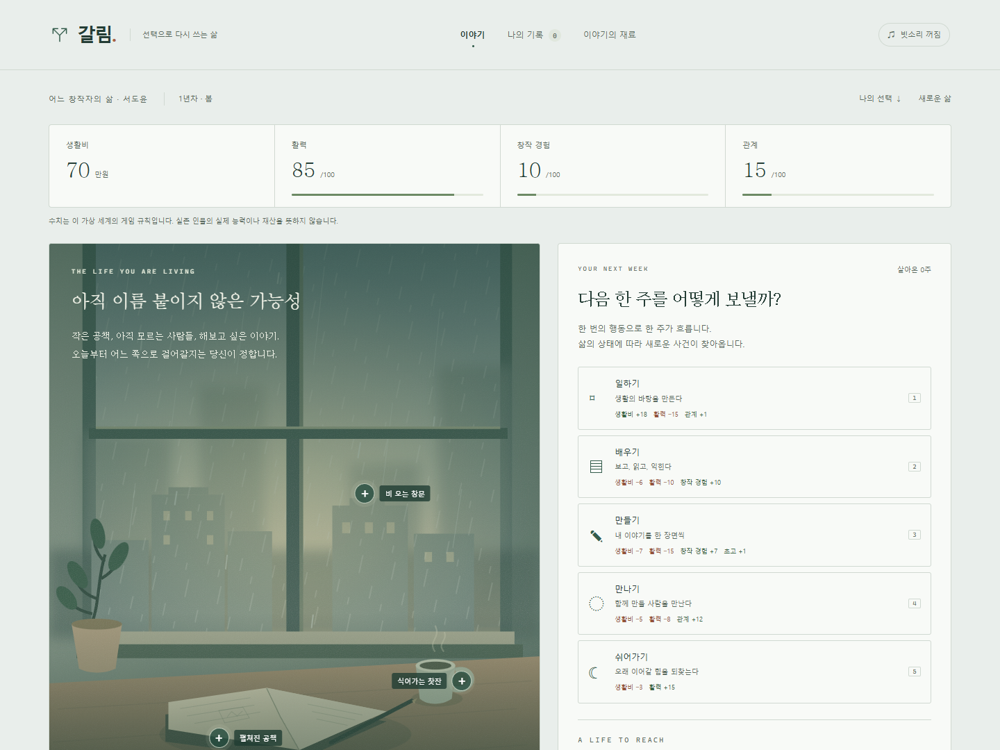
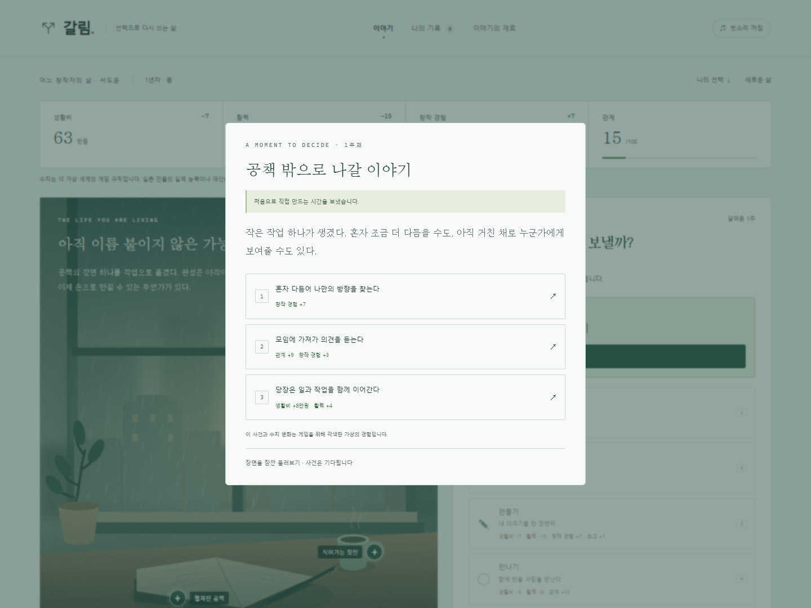
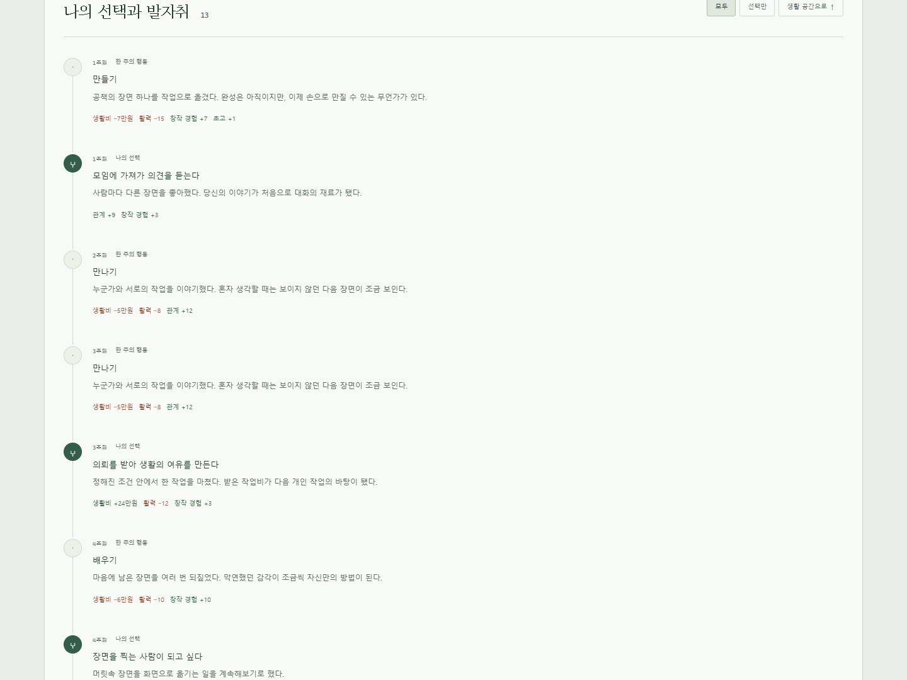

<div align="center">

# 갈림 · L:IF:E

**선택을 넘어, 한 사람의 삶으로.**

일하고, 배우고, 만들고, 만납니다.<br>
변화하는 생활과 뜻밖의 사건 속에서, 당신만의 삶을 이어갑니다.

[](LICENSE)
[](CONTENT_LICENSE.md)
[](game/dist/life-app.js)
[](https://github.com/jeiel85/l-if-e/actions/workflows/ci.yml)

[**라이브 데모 플레이 ↗**](https://galim-first-life.spicystar16.chatgpt.site) · [변경 기록](CHANGELOG.md) · [검증 기록](docs/verification-v0.3.0.md)



</div>

## 어느 창작자의 삶

첫 번째 주인공은 가상의 인물 **서도윤**입니다. 공책에 이야기를 그리던 기억, 함께 영화를 보던 작은 모임, 계획에 없던 비가 내리던 촬영에서 출발합니다. 공개된 창작자의 경험에서 소재를 얻되 인물·대화·사건·선택·수치·결과를 게임에 맞게 각색했습니다.

이름을 맞히는 정답은 공개하지 않습니다. 실존 인물의 실제 능력·재산·건강이나 다른 미래를 수치로 예측한다고 주장하지 않습니다. 참고 자료는 게임 내 접힌 출처 항목에서 확인할 수 있습니다.

## v0.3.0 · 정해진 여섯 번의 선택을 넘어

| 바뀐 경험 | 작동 방식 |
| --- | --- |
| **계속 남아 있는 화면** | 생활 공간을 유지한 채 수치·문구를 갱신합니다. 선택이 필요한 사건만 팝업으로 열립니다. |
| **아래로 쌓이는 히스토리** | 행동·선택·그 결과와 실제 수치 변화가 시간 순서대로 남습니다. ‘선택만’ 필터도 있습니다. |
| **실제로 영향을 주는 네 수치** | 생활비·활력·창작 경험·관계가 행동 비용과 선택 가능 여부, 사건·작업·목표 달성을 바꿉니다. |
| **내가 사는 한 주** | 일하기·배우기·만들기·만나기·쉬어가기로 한 주를 보냅니다. 비용과 변화는 행동 전에 보입니다. |
| **상태에 따라 찾아오는 사건** | 모인 초고, 완성작, 사람들과의 관계, 생활비와 활력, 이전 사건의 대기 시간이 다음 사건을 만듭니다. |
| **목표 뒤에도 이어지는 삶** | 나만의 작품으로 세계 무대에 닿으면 이룬 삶을 보여주고 한 번 묻습니다. 계속 살거나 여기까지를 기록할 수 있습니다. |

고정된 마지막 주와 선택 횟수는 없습니다. 생활비가 부족하거나 피로해져도 도움·작은 일·무료 회복을 통해 계속할 수 있습니다. 수치에는 실제 인물을 평가하는 의미가 없고, 이 가상 세계의 규칙으로만 사용합니다.

| 결정이 필요한 순간 | 지나온 선택과 발자취 |
| --- | --- |
|  |  |

## 플레이 방법

1. **이 삶에 들어가기**를 눌러 시작합니다.
2. 현재 생활비·활력·창작 경험·관계를 보며 한 주의 행동을 고릅니다. 데스크톱에서는 숫자 키 `1`–`5`도 사용할 수 있습니다.
3. 사건이 찾아오면 팝업에서 선택합니다. 자원이나 경험이 모자란 대안은 조건을 표시하고 닫힙니다.
4. 생활 공간 아래에서 지나온 행동과 결정을 돌아봅니다. 새로고침해도 현재 주와 수치·기록을 이어갑니다.
5. 초고를 쌓아 작품을 완성하고 다른 사람에게 소개합니다. **완성작 3편 · 국제 초청 2회 · 창작 경험 65 이상 · 관계 40 이상**이 첫 삶의 목표입니다.
6. 목표에 도달하면 ‘계속 살기’ 또는 ‘여기까지 기록하기’를 고릅니다. 계속 살기를 골라도 나중에 기록할 수 있습니다.

국제 초청은 실제 심사·수상 확률 예측이 아닙니다. 표시된 조건을 충족하면 얻는 게임 성취입니다. 일반 사건의 변주는 저장된 난수 상태와 현재 조건으로 선정합니다.

사건 창을 잠깐 닫아 주변과 히스토리를 볼 수 있습니다. 사건은 대기 상태로 남으며, 해결 전에는 다른 주로 넘길 수 없습니다.

## 내 공책과 기억 조각

그림 속 `+`를 눌러 공책·창문·찻잔의 기억 조각을 모을 수 있습니다. 공책에는 제목을 붙이고 세 컷의 순서를 바꿔 짧은 이야기를 재생할 수 있습니다. 모두 선택 사항이며 목표 달성에 필수는 아닙니다.

입력한 제목은 최대 40자이고 현재 기기에만 저장됩니다. 이 물건과 문구·컷은 게임을 위해 창작했습니다.

## 이전 버전의 기록

기존 v0.1–0.2의 여섯 장면 방식은 [이전 버전 페이지](https://galim-first-life.spicystar16.chatgpt.site/legacy.html#records)에서 그대로 열 수 있습니다. 새 게임의 ‘나의 기록’에서도 연결합니다. 기존 진행과 완료 기록을 새 수치로 임의 변환하거나 덮어쓰지 않습니다.

이전 방식의 [시나리오 설계](docs/episode-01-design.md)에는 조사 대상이 나옵니다. 정체를 추측하며 플레이하고 싶다면 나중에 읽어 주세요.

## 로컬 실행과 배포

**Node.js 22 이상**이 필요합니다. 외부 패키지 설치·API 키·데이터베이스가 필요하지 않습니다.

```bash
git clone https://github.com/jeiel85/l-if-e.git
cd l-if-e
npm start
```

[http://127.0.0.1:4317](http://127.0.0.1:4317)을 엽니다. `file://`로 직접 열지 말고 HTTP 서버로 실행해 주세요. `PORT` 환경 변수로 포트를 바꿀 수 있습니다.

```powershell
# PowerShell
$env:PORT = '8080'
npm start
```

```bash
# macOS / Linux
PORT=8080 npm start
```

```bash
npm run check
npm test
npm run build
```

`build`는 `game/dist/`를 루트 `dist/`에 복사하고 파일의 바이트 일치를 확인합니다. 정적 배포 디렉터리는 **`dist/`**입니다. 로컬 서버는 미리보기 전용입니다. Sites 설정은 `.openai/hosting.json`에 있으며, 포크를 별도 사이트로 배포할 때는 새 사이트의 프로젝트 ID를 사용해야 합니다.

## 검증과 구조

Node 내장 러너의 **15개 테스트**가 기존 분기와 새 생활 엔진을 검사합니다. 16개 시드 × 350단계의 장기 진행, 자원 제약, 사건 선택 가능성, 목표 도달·계속 살기·저장 구조를 확인합니다. 이전 방식의 729개 조합 검증도 유지했습니다. GitHub Actions는 문법 검사·테스트·정적 빌드를 실행합니다.

[현재 브라우저 검증](docs/verification-v0.3.0.md) · [v0.2.0 검증](docs/verification-v0.2.0.md) · [첫 버전 검증](docs/verification.md) · [데이터 형식과 설계 결정](DECISIONS.md)

```text
game/dist/
  index.html          # 현재 게임의 시작점
  life-app.js         # 지속되는 공간·사건 팝업·수치·히스토리·저장
  life-engine.js      # 한 주의 행동·자원·조건부 사건·목표·검증
  life.css            # 생활 화면과 사건 창의 스타일
  interactions.js     # 공책·세 컷·기억 조각 데이터
  art.svg             # 직접 제작한 창가 일러스트
  legacy.html         # 이전 방식의 플레이·기록 진입점
  app.js, story.js    # 기존 여섯 장면 방식과 분기 비교
  style.css           # 공통 디자인과 이전 화면 스타일
game/tests/           # 생활 엔진·기존 분기·공책 검증
scripts/              # 의존성 없는 로컬 서버와 정적 빌드
docs/                 # 기획·검증·스크린샷
LICENSE               # 코드 MIT
CONTENT_LICENSE.md    # 콘텐츠 CC BY 4.0의 적용 범위
LICENSES/CC-BY-4.0.txt # 콘텐츠 라이선스 전문
```

새로운 사건은 `life-engine.js`의 `EVENTS`에서 작성하고 발생 조건을 `selectEvent()`에 연결합니다. 선택 비용·필요 경험·실제 변화는 같은 엔진에서 검사합니다. 가상의 결과를 실제 인물의 선택이나 확정된 미래로 표시하지 않습니다.

## 저장과 개인정보

현재 진행은 `galim.life.v1`, 기록한 삶은 `galim.lives.v1`에 저장합니다. 완료 기록은 최근 20개를 유지합니다. 기존 `galim.save.v1`과 `galim.records.v1`은 이전 게임 전용으로 남겨둡니다.

로그인·서버 데이터베이스·분석 SDK·외부 AI 호출이 없습니다. 선택·수치·공책·난수 상태는 현재 브라우저의 `localStorage`에 남으며 기기 간 동기화되지 않습니다. 브라우저 데이터를 삭제하면 기록도 삭제됩니다. 기록 화면에서 텍스트를 복사해 별도로 보관할 수 있고, 클립보드가 막히면 선택 가능한 텍스트 창을 제공합니다. 호스팅 서비스의 자체 접속 로그 정책은 별도로 적용됩니다.

## 라이선스와 기여

- **소스 코드: [MIT](LICENSE).** 저작권 고지와 라이선스를 유지해 수정·재배포할 수 있습니다.
- **직접 만든 콘텐츠: [CC BY 4.0](CONTENT_LICENSE.md).** 저작자·원본·라이선스를 표시하고 변경 사실을 밝혀 주세요.
- **외부 인터뷰·사진·영상 및 실존 인물에 관한 권리**는 위 라이선스에 포함되지 않습니다. 외부 사진·음원·웹 폰트를 게임에 넣지 않았습니다. 빗소리는 Web Audio API로 직접 합성합니다.

> 「갈림 (L:IF:E)」 — jeiel85 · https://github.com/jeiel85/l-if-e · [CC BY 4.0](https://creativecommons.org/licenses/by/4.0/) · 수정 시 변경 사실 표시

[Issues](https://github.com/jeiel85/l-if-e/issues)에는 사용 브라우저와 재현한 행동·사건, 예상 동작과 실제 동작을 남겨 주세요. PR의 코드 기여는 MIT, 오리지널 콘텐츠 기여는 CC BY 4.0 적용에 동의하는 범위에서 제출해 주세요.
